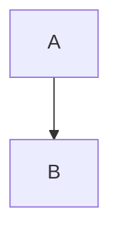

# Extensions

> [!NOTE]
> Useful information.

> [!TIP]
>
> Separate paragraph.

> [!important]
> Mixed case marker.

> [!WARNING]  
> Hard break after the marker.

> [!CAUTION]
> Last one, with a list:
> - a

> [!NOTE]

> [!NOTE] with a title is not an alert
> body

- > [!TIP]
  > inside a list item stays a blockquote

Footnotes[^1], a named one[^note] and a repeat[^1].

[^1]: The first footnote.
[^note]: A footnote ending in a list:

    - item

Inline math $E = mc^2$, in parentheses ($x$), with backticks $`\frac{1}{2}`$, escaped \$5,
not math $5 and $10, x$y$ and $x$y.

$$
\int_0^\infty e^{-x^2} dx
$$

```math
\begin{pmatrix} a & b \\
c & d \end{pmatrix}
```

Emoji :smile: :+1: :warning: :octocat: and raw ↗️; once the first match qualifies x:smile: converts too.

Untouched: x:smile: (first match not at a boundary), :SMILE: and `:smile:`.



```geojson
{"type": "Point", "coordinates": [0, 0]}
```

```rust title="main.rs"
fn main() {}
```

```
no language
```

    indented code

<details>
<summary>Summary :tada:</summary>

Hidden **markdown**.

</details>
