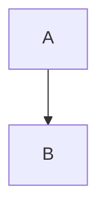

```ruby:red gem
puts 1
```

```
no language

```

```Python
wrong case stays canonical
```

```math
\alpha + \beta
```



```suggestion:-0+1
replacement
```

```plantuml
Bob -> Alice : hello
```

```json:table
{"items": []}
```

```js
```

    indented
    code

Inline math $a^2$, $`b^2`$ and display:

$$
c^2
$$
